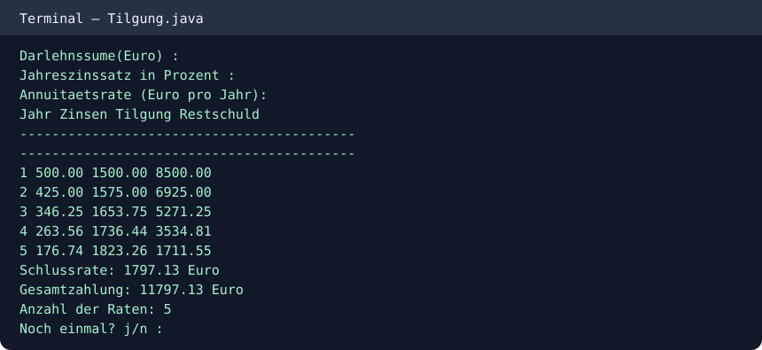

# Loan Repayment Calculator (Java)

A console-based Java project that creates an annual loan repayment (Tilgung) schedule.

## Features
- Accepts the loan principal, annual interest rate, and annual annuity.
- Prints interest, principal repayment, and remaining balance for each year.
- Calculates the final payment and total amount paid.

## Run

```bash
javac -d out src/Tilgung.java
java -cp out Tilgung
```

Enter a principal, interest percentage and annual annuity when prompted.

## Console example


This is a student programming exercise. It demonstrates an amortization schedule for a sample input; validate calculations and inputs before using for real financial decisions.